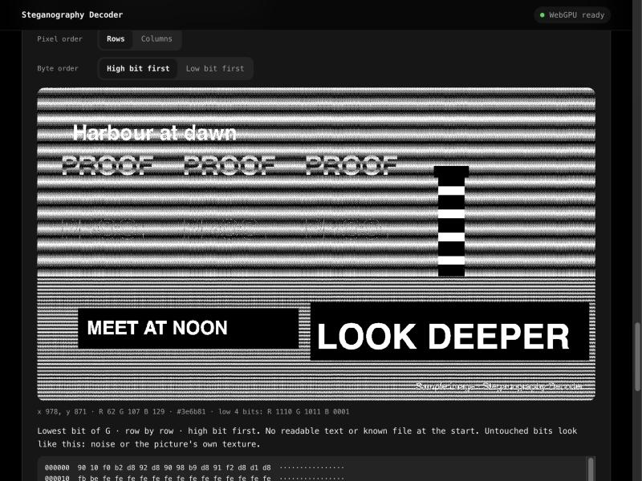
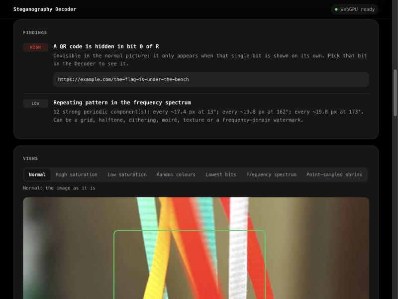
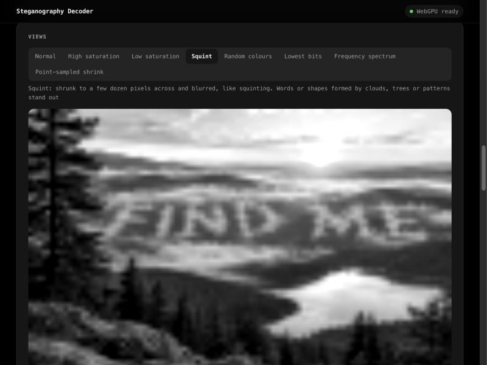
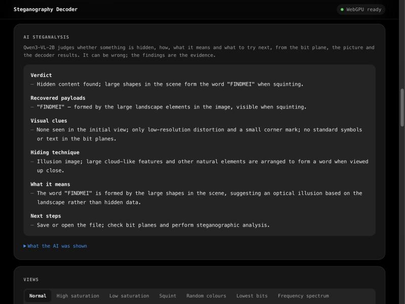
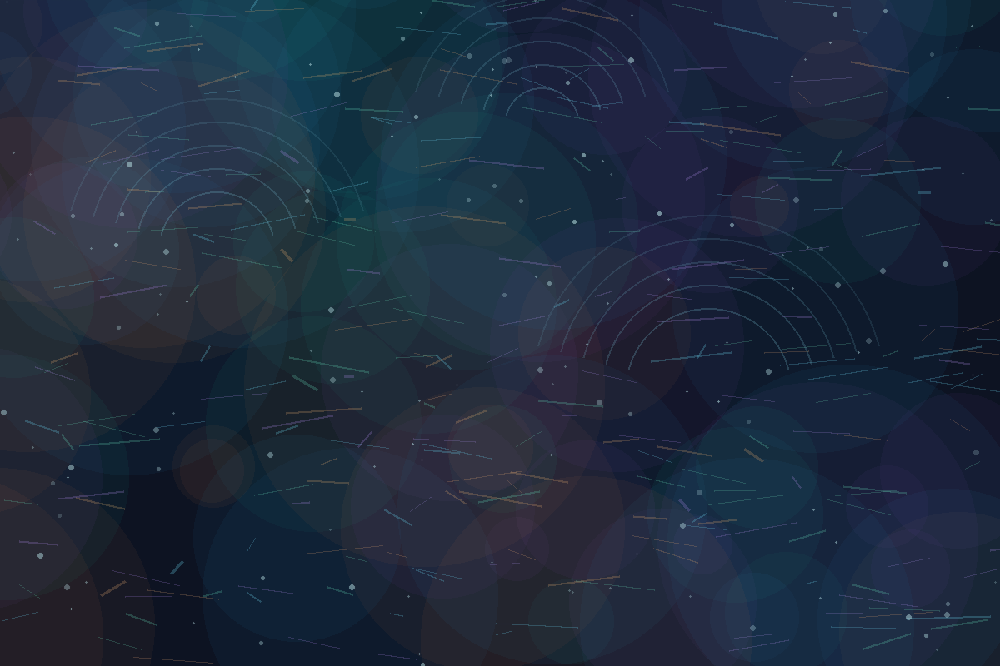

# Steganography Decoder

Find and decode what an image is hiding: messages in the pixels' bits, files attached or embedded, faint text and watermarks. Everything runs in your browser, including the two AI models that read text and explain the findings. No server, no API key, and your image never leaves the page.

**[▶ Try the live demo on Hugging Face Spaces](https://huggingface.co/spaces/GHeart01/steganography-decoder)**

<table>
  <tr>
    <td width="50%"></td>
    <td width="50%"></td>
  </tr>
  <tr>
    <td><b>What you see:</b> twenty colour stripes. The purple boxes mark where the app found something you can't see.</td>
    <td><b>What the app sees:</b> seven letters, each only 5–18 shades off its stripe. Read in order, they spell <b>REACHES</b>.</td>
  </tr>
</table>

Run this image through the app and it reports: **7 faint shapes hidden in flat colour** and **The faint shapes spell “REACHES”**. Try it yourself: it's the *Colour stripes* demo in the [live app](https://huggingface.co/spaces/GHeart01/steganography-decoder).

## The decoder

Every analysis scans the pixels the way steganography tools write into them: 60 combinations (84 with alpha) of colour channels (RGB, BGR, each channel alone, and alpha when the image has one), bit positions (bit 0, bit 1, bits 1 and 0), pixel order (rows or columns) and byte order. A combination counts only if it gives readable text or a known file signature (PNG, JPEG, GIF, ZIP, PDF, 7-Zip, RAR, gzip, WebP). Tool framing such as Stegano's length prefix or a `#####` end marker is stripped, and Base64, hex and binary text is decoded, up to three layers deep.

The Decoder panel lists the hits. Open one, or pick any channels and bits yourself, to see that bit plane as a picture, read a hex dump of the bytes, and save them. Embedded files are cut at their real end (PNG `IEND`, the JPEG end marker, the ZIP directory record, PDF `%%EOF`). Data appended after the end of the image file can be saved from the File card.


More tools in the panel:

- **Every bit plane at a glance.** A grid of all 24 planes (32 with alpha). A word, QR code or picture drawn into one bit is invisible in the image but jumps out in its tile. Click a tile to open that plane full size.
- **Search the whole image.** The automatic scan reads the first 4 KB of each ordering, which is where sequential tools write. This button reads every bit of every ordering, about a second, for messages placed further in.
- **Pixel readout.** Point at any picture to see that pixel's position, RGB values, hex colour and lowest four bits per channel.
- **QR codes** are looked for in the picture, its saturated view and the two lowest bit planes of each channel, in a background worker. A code hidden in a single bit plane is reported as hidden data.





The Harbour sample hides three messages in its bits. The scan reads the first in the lowest bit of R, G and B, and the second in bit 1 of blue, read column by column, as Base64. The third, “LOOK DEEPER”, is drawn as a picture into green's lowest bit, so no byte scan can read it: the grid shows it, Florence-2 reads it from that plane, and it's reported as hidden text.

## What the AI adds

The decoders read bytes; the models read pictures. That covers hiding that byte scans and statistics can't see:

- **Pictures hidden in bits.** Words, a logo or a second image drawn into one bit plane come out of a byte scan as gibberish. Florence-2 reads text in the lowest plane of each channel (ignoring the echoes of the picture's own visible text), and Qwen3-VL-2B gets a grid of the two lowest planes of each channel to look for anything else.
- **Words formed by the scene.** AI “illusion” images arrange clouds, trees or patterns into words you only see when you squint. The Squint view does the squinting (shrink to a few dozen pixels, blur, stretch contrast), Florence-2 reads it, and Qwen gets it as an extra picture.
- **Codes drawn in the scene.** Morse dots and dashes, binary as marks, braille, pigpen, objects that are deliberately counted or placed. These are shapes, not bits.
- **Meaning.** Connecting recovered messages to each other and to the picture (“the third stone from the lighthouse” in a picture of a lighthouse), and suggesting where to look next.

What it can't do: read bits itself, or be fully trusted. At 2B parameters it can miss things or invent them, so the decoders produce the evidence and the model only interprets it.

### Tested: can the models find words and figures hidden in a scene?

Two AI-generated illusion images: clouds spelling **FIND ME** over a valley, and a **fox's head** outlined in sunset clouds.

| | Hidden words (FIND ME) | Hidden figure (fox) |
|---|---|---|
| Qwen3-VL-2B on the full picture | Missed: "a normal landscape" | Missed: "nothing hidden" |
| Qwen3-VL-2B on the squint view, asked directly | Missed | Missed |
| Florence-2 captions or object detection on the squint view | Noise ("vehicle", "horse") | Noise ("toilet", "window") |
| **Florence-2 reading the squint view** | **Found: "FINDMEI"** (FIND ME plus a stray stroke) | — |

So hidden *words* are found, by squinting and reading rather than by asking the AI to look, and Qwen then explains them. Hidden *figures* like the fox are beyond both small models; seeing them reliably would need a larger vision model than a laptop browser can run, or a dedicated shape classifier. The Squint view still shows the fox to a person.





## Real demos

All of these are one-click demos in the app, and everything shown is the app's actual output.


<p>
  
  
</p>

| | Quiet signal | Colour stripes |
|---|---|---|
| **What it is** | A starfield of translucent circles and streaks | Twenty flat colour stripes |
| **Hidden in the bits** | The lowest bit of R, G and B, read row by row: **THE QUIETEST SIGNAL CARRIES THE MESSAGE** | Nothing |
| **Hidden in the picture** | Nothing | Seven letters, each only 5–18 shades off its stripe, spelling **REACHES** |
| **Found by** | The bit scan, in under a second | The faint-mark check, read by Florence-2 |

### Colour stripes: findings and AI steganalysis

The faint-mark check finds seven shapes that differ from their stripe by only a few shades, lines them up in reading order and reads them: **REACHES**.


The report gets the payload right but also shows the model's limits: its hiding-technique line claims “bit-level manipulation”, which the findings don't support. The letters are a few shades off, not hidden in the bits. That's why the findings come first.

### More demos in the app

- **Ribbons:** a real photo whose content credentials (C2PA) record it being opened and colour-adjusted.
- **Harbour:** a generated test image. The app finds everything planted: a ZIP file attached after the image, a sentence in the lowest bits, a Base64 sentence in bit 1 of blue, the words “LOOK DEEPER” drawn into green's lowest bit, a PNG comment, a 4%-opacity "PROOF" watermark, and colour-camouflaged text.

## What it checks

| Layer | How | Model |
|---|---|---|
| **File structure** | EXIF, XMP and PNG text fields; AI-generation prompts (Stable Diffusion, ComfyUI); non-standard blocks; data appended after the image | none |
| **Content credentials** | Reads the C2PA manifest: declared source (camera, AI-generated, AI-edited…), the tool that made it, and recorded steps such as edits or an added invisible watermark | none |
| **Hidden bits** | Scans 60 channel, bit and order combinations (84 with alpha) for text and file signatures, strips tool framing, and decodes Base64, hex and binary. Also runs a chi-square attack, and compares aligned and misaligned value pairs in flat areas, counting only scattered flips (a solid faint shape isn't noise) | none |
| **Bit planes and colours** | Any bit of any channel as a picture, and a random colour map that gives every distinct colour its own colour, so shades one step apart stand out | none |
| **Squint** | Shrinks the picture to a few dozen pixels across, blurs it and stretches contrast, so words formed by clouds or patterns stand out; Florence-2 reads the result | Florence-2-base |
| **Text in bit planes** | Reads the lowest bit plane of each channel as a picture and keeps words that aren't also visible in the image | Florence-2-base |
| **QR codes** | jsQR over the picture, its saturated view and the two lowest bit planes of each channel | none |
| **Faint marks** | In flat-colour artwork: shapes enclosed by one flat area and only a few shades off its colour. Shown amplified in a Faint marks view, lined up in reading order and read with OCR | Florence-2-base (to read them) |
| **Frequency** | 2-D FFT; isolated peaks reveal grids, halftone, moiré and frequency watermarks | none |
| **Colour** | Palette with plain colour names, saturation, histogram gaps, lowest-bit colour twins | none |
| **Resizing** | Compares an averaged and a point-sampled shrink to catch image-scaling attacks | none |
| **Text** | OCR on 768 px tiles of three views (normal, high saturation, low saturation). Text that only appears in an enhanced view is flagged | [Florence-2-base](https://huggingface.co/onnx-community/Florence-2-base-ft), ~360 MB |
| **Corner logos** | Each corner is cropped and Florence-2 is asked to locate "logo". With nothing there it returns the whole crop; a small, tight box near the edges is a mark | Florence-2-base |
| **AI steganalysis** | Gets the image shrunk to ~0.5 megapixel, a grid of its two lowest bit planes per channel, close-ups of flagged regions, the recovered payloads, the detected hiding techniques and all findings. Writes a report under six headings: verdict, recovered payloads, visual clues, hiding technique, what it means, next steps | [Qwen3-VL-2B-Instruct](https://huggingface.co/onnx-community/Qwen3-VL-2B-Instruct-ONNX), ~1.4 GB |

The pixel and file checks finish in under a second. Once the models are stored, they load in the background when the page opens, and a full 1920×1080 analysis takes about 25 seconds on an idle Apple Silicon laptop (closer to 45–50 seconds when the machine is busy).

## Design

One monospace type stack (SF Mono, Cascadia Mono and friends: no web fonts, so nothing is fetched beyond the app and its models), Apple-style materials (a translucent top bar with a live model-status pill, switches, a segmented control) and restrained motion: press feedback, hover only on real pointers, a short staggered reveal for results, and everything reduced under `prefers-reduced-motion`. Light and dark follow the system.

## Quick start

Run it locally with any static file server. You need one because browsers block ES modules on `file://` pages.

```bash
git clone https://github.com/GHeart01/steganography-decoder.git
cd steganography-decoder
python3 -m http.server 8000
```

Open <http://localhost:8000> and click a demo. Text reading and AI steganalysis need a browser with WebGPU (Chrome, Edge or Safari 26+). Without WebGPU, the file and pixel checks still work, and text reading is designed to fall back to the CPU (slower, and untested so far).

## How it works

1. **Exact pixels.** PNGs are decoded in JavaScript, so pixel values are exact. Browser (canvas) decoding can be altered by colour management and by anti-fingerprinting noise, which would destroy lowest-bit evidence. The app tests for that noise and warns when it's present.
2. **File and pixel checks** run on the main thread in [`lib/`](../lib): [`metadata.js`](../lib/metadata.js) for the file structure and C2PA, [`stego.js`](../lib/stego.js) for bit extraction, the scan, decoding and file carving, [`forensics.js`](../lib/forensics.js) for the statistical bit tests, frequency, colour and resizing, and [`views.js`](../lib/views.js) for the saturation views.
3. **The models run in a Web Worker** ([`worker.js`](../worker.js)) with [Transformers.js](https://huggingface.co/docs/transformers.js) on WebGPU. With 8 GB or more of memory both stay loaded between images; on smaller machines only one is kept at a time, because integrated GPUs share system RAM. The worker runs one model job at a time: ONNX Runtime stalls if a model is set up while another is running.
4. **Text reading** cuts each view into overlapping 768 px tiles (Florence-2's input size) and merges the reads ([`pipeline.js`](../lib/pipeline.js)). Reads at the same place are combined even when tiles or views spell them differently.
5. **Steganalysis** sends Qwen3-VL the picture, a grid of its lowest bit planes and the decoder results, and asks for a verdict, the payloads, the technique, their meaning and next steps. The decoders do the decoding; the model explains. Text taken from the image or file goes inside a delimited data block that the model is told never to follow, and `<` and `>` are stripped so that text can't close the block early.

### Storage

The models download once and are stored in the browser's private file system (OPFS) rather than the Cache API, which refused Qwen's 995 MB weights file in testing. The page shows what's stored and has a **Remove downloaded models** link.

## Tests

The checks are tested against planted ground truth and clean controls. The decoder tests include images made with a real tool ([Stegano](https://github.com/cedricbonhomme/Stegano)), every ordering round-tripped, the whole-image search, file carving, decoding, a QR code hidden in one bit plane, and the real demo images as clean controls. Other tests cover cases found on real images: dithered gradients, near-black noise, OCR misreads at tile edges, tall phantom text boxes, and the soft edges of faint letters.

```bash
cd tests
npm install
npm test
```

## Deploy your own copy

The app is a free **static** [Hugging Face Space](https://huggingface.co/docs/hub/spaces). With the [`hf` CLI](https://huggingface.co/docs/huggingface_hub/guides/cli) logged in (`hf auth login`), run this from the repo folder, replacing `<username>`:

```bash
hf repos create <username>/steganography-decoder --type space --sdk static
```
```bash
hf upload <username>/steganography-decoder . --type space --exclude ".git/*" --exclude ".github/*" --exclude "tests/node_modules/*"
```

The root [`README.md`](../README.md) holds the Space's settings in its front matter, so keep that file. This page lives in `.github/README.md` so that GitHub shows it instead. Any other static host works too.

## Limitations

- **Password-protected and JPEG-coefficient hiding can't be decoded.** Tools that scramble with a key (steghide, OutGuess, OpenStego with a password) or hide in JPEG compression coefficients (F5, JSteg) need the key or the tool. The statistical checks may still notice them.
- **The automatic scan reads the start of each bit stream** (the first 4 KB per combination), which is where sequential tools write. **Search the whole image** in the Decoder reads all of it.
- **QR codes in bit planes** are read at up to 800 px, so a hidden code needs modules of about 3 px or more in a 1920 px image.
- **Lossy files:** JPEG and WebP compression rewrite the lowest bits, so hidden-bit results on those formats are weak evidence.
- **Invisible model watermarks** (OpenAI's, SynthID, Stable Diffusion's DWT-DCT mark) can't be decoded; they need the maker's detector. The app reports when content credentials *say* one was added.
- **Content credentials aren't verified.** The app reads what the manifest claims; check the signature at [contentcredentials.org/verify](https://contentcredentials.org/verify).
- **Logos away from the corners:** there's no trained logo or watermark detector. Corner marks are found by the grounding check above; elsewhere, watermarks are inferred from repeated text, text that appears only after enhancement, and the AI's reading.
- **The AI steganalysis can be wrong.** Qwen3-VL-2B is small: in testing it sometimes mixed up which payload came from where, or suggested steghide when it wasn't needed. The decoders' findings always appear above it. It is guided by its prompt and inputs, not fine-tuned on steganography.
- **Tested in Chrome on Apple Silicon.** The no-WebGPU path, Safari and 16-bit PNGs haven't been tested.

## Credits

- Models: [Florence-2-base](https://huggingface.co/microsoft/Florence-2-base-ft) (MIT) and [Qwen3-VL-2B-Instruct](https://huggingface.co/Qwen/Qwen3-VL-2B-Instruct) (Apache-2.0), using the ONNX exports from [onnx-community](https://huggingface.co/onnx-community)
- Runtime: [Transformers.js](https://github.com/huggingface/transformers.js) by Hugging Face
- PNG decoding: [fast-png](https://github.com/image-js/fast-png)
- Demo images: see [`demo/README.md`](../demo/README.md)
