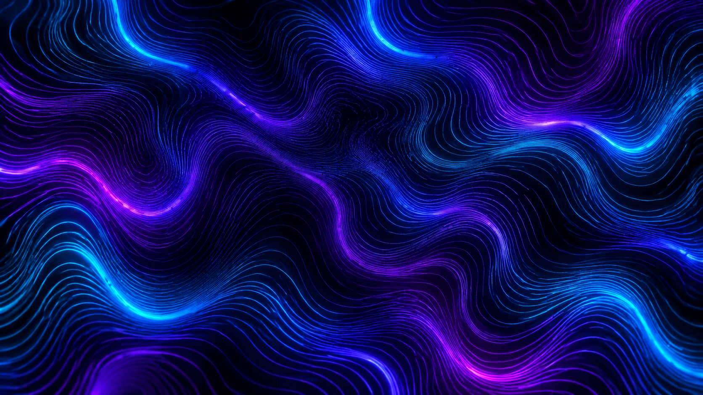
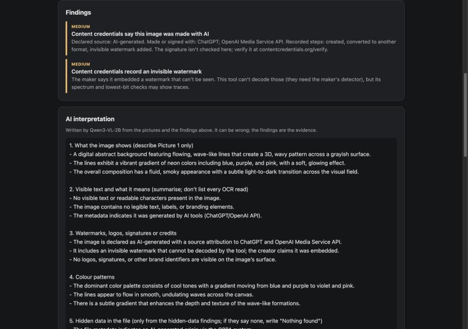
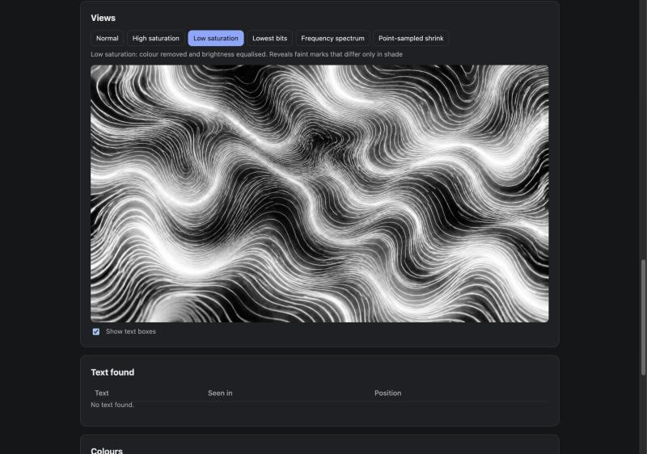

# AI Image Decoder

Find text, watermarks, colour patterns and hidden data in an image, with AI models that run entirely in your browser. No server, no API key, and your image never leaves the page.

**[▶ Try the live demo on Hugging Face Spaces](https://huggingface.co/spaces/GHeart01/ai-image-decoder)**


## Real demo: two ChatGPT images

These two images were generated with ChatGPT. Both are one-click demos in the app, and everything below is the app's actual output.

<p>
  
  
</p>

| | Alpine lake | Neon waves |
|---|---|---|
| **Content credentials (C2PA)** | AI-generated, made with ChatGPT / OpenAI Media Service API | Same |
| **Recorded steps** | Created, converted to another format, invisible watermark added | Same |
| **Visible text** | None | None |
| **Hidden data in the pixels or file** | None | None |

### Alpine lake: findings and AI interpretation

The file checks read the credentials; Qwen3-VL-2B then describes the scene and explains what the credentials mean.


### Alpine lake: high-saturation view

Exaggerating colour differences is how the app exposes marks that blend into the image. Here it makes the small faint logo in the top-right corner easier to see.


### Neon waves: findings and AI interpretation



### Neon waves: low-saturation view

Removing colour and equalising brightness shows the structure of the line field, and any faint mark that differs only in shade.



### More demos in the app

- **Edited photo with credentials:** a real photo whose credentials record it being opened and colour-adjusted.
- **Planted hidden content:** a generated test image. The app finds everything planted: a ZIP file attached after the image, a sentence hidden in the pixels' lowest bits, a PNG comment, a 4%-opacity "PROOF" watermark, and colour-camouflaged text.

## What it checks

| Layer | How | Model |
|---|---|---|
| **File structure** | EXIF, XMP and PNG text fields; AI-generation prompts (Stable Diffusion, ComfyUI); non-standard blocks; data appended after the image | none |
| **Content credentials** | Reads the C2PA manifest: declared source (camera, AI-generated, AI-edited…), the tool that made it, and recorded steps such as edits or an added invisible watermark | none |
| **Lowest bits** | Extracts messages in the orderings simple tools use, runs a chi-square attack, and compares aligned and misaligned value pairs in flat areas | none |
| **Frequency** | 2-D FFT; isolated peaks reveal grids, halftone, moiré and frequency watermarks | none |
| **Colour** | Palette with plain colour names, saturation, histogram gaps, lowest-bit colour twins | none |
| **Resizing** | Compares an averaged and a point-sampled shrink to catch image-scaling attacks | none |
| **Text** | OCR on 768 px tiles of three views (normal, high saturation, low saturation). Text that only appears in an enhanced view is flagged | [Florence-2-base](https://huggingface.co/onnx-community/Florence-2-base-ft), ~360 MB |
| **Interpretation** | Gets the image shrunk to ~1 megapixel, a saturated copy, close-ups of flagged regions and all findings, and writes a short report | [Qwen3-VL-2B-Instruct](https://huggingface.co/onnx-community/Qwen3-VL-2B-Instruct-ONNX), ~1.4 GB |

The pixel and file checks finish in about a second. With the models stored, a full 1920×1080 analysis takes 45–70 seconds on a laptop GPU.

## Quick start

Run it locally with any static file server. You need one because browsers block ES modules on `file://` pages.

```bash
git clone https://github.com/GHeart01/ai-image-decoder.git
cd ai-image-decoder
python3 -m http.server 8000
```

Open <http://localhost:8000> and click a demo. Text reading and AI interpretation need a browser with WebGPU (Chrome, Edge or Safari 26+). Without WebGPU, the file and pixel checks still work, and text reading is designed to fall back to the CPU (slower, and untested so far).

## How it works

1. **Exact pixels.** PNGs are decoded in JavaScript, so pixel values are exact. Browser (canvas) decoding can be altered by colour management and by anti-fingerprinting noise, which would destroy lowest-bit evidence. The app tests for that noise and warns when it's present.
2. **File and pixel checks** run on the main thread in [`lib/`](../lib): [`metadata.js`](../lib/metadata.js) for the file structure and C2PA, [`forensics.js`](../lib/forensics.js) for the lowest bits, frequency, colour and resizing, and [`views.js`](../lib/views.js) for the saturation views.
3. **The models run in a Web Worker** ([`worker.js`](../worker.js)) with [Transformers.js](https://huggingface.co/docs/transformers.js) on WebGPU. Only one model is in memory at a time, because integrated GPUs share system RAM.
4. **Text reading** cuts each view into overlapping 768 px tiles (Florence-2's input size) and merges the reads ([`pipeline.js`](../lib/pipeline.js)). Reads at the same place are combined even when tiles or views spell them differently.
5. **Interpretation** sends Qwen3-VL several pictures plus the findings. Text taken from the image or file goes inside a delimited data block that the model is told never to follow, and `<` and `>` are stripped so that text can't close the block early.

### Storage

The models download once and are stored in the browser's private file system (OPFS) rather than the Cache API, which refused Qwen's 995 MB weights file in testing. The page shows what's stored and has a **Remove downloaded models** link.

## Tests

The forensic checks are tested against planted ground truth and clean controls, including several cases found on real images: dithered gradients, near-black noise, OCR misreads at tile edges, and tall phantom text boxes.

```bash
cd tests
npm install
npm test
```

## Deploy your own copy

The app is a free **static** [Hugging Face Space](https://huggingface.co/docs/hub/spaces). With the [`hf` CLI](https://huggingface.co/docs/huggingface_hub/guides/cli) logged in (`hf auth login`), run this from the repo folder, replacing `<username>`:

```bash
hf repos create <username>/ai-image-decoder --type space --sdk static
```
```bash
hf upload <username>/ai-image-decoder . --type space --exclude ".git/*" --exclude ".github/*" --exclude "tests/node_modules/*"
```

The root [`README.md`](../README.md) holds the Space's settings in its front matter, so keep that file. This page lives in `.github/README.md` so that GitHub shows it instead. Any other static host works too.

## Limitations

- **Lossy files:** JPEG and WebP compression rewrite the lowest bits, so hidden-bit results on those formats are weak evidence.
- **Invisible model watermarks** (OpenAI's, SynthID, Stable Diffusion's DWT-DCT mark) can't be decoded; they need the maker's detector. The app reports when content credentials *say* one was added.
- **Content credentials aren't verified.** The app reads what the manifest claims; check the signature at [contentcredentials.org/verify](https://contentcredentials.org/verify).
- **Small logos:** there's no trained logo or watermark detector. Watermarks are inferred from repeated text, text that appears only after enhancement, and the AI's reading. The small faint logo in the alpine lake image's top-right corner isn't flagged as a finding, though the high-saturation view shows it.
- **The AI interpretation can be wrong.** Qwen3-VL-2B is small: in testing it sometimes named colours wrong or left a finding out of its summary. The raw findings always appear above it.
- **Tested in Chrome on Apple Silicon.** The no-WebGPU path, Safari and 16-bit PNGs haven't been tested.

## Credits

- Models: [Florence-2-base](https://huggingface.co/microsoft/Florence-2-base-ft) (MIT) and [Qwen3-VL-2B-Instruct](https://huggingface.co/Qwen/Qwen3-VL-2B-Instruct) (Apache-2.0), using the ONNX exports from [onnx-community](https://huggingface.co/onnx-community)
- Runtime: [Transformers.js](https://github.com/huggingface/transformers.js) by Hugging Face
- PNG decoding: [fast-png](https://github.com/image-js/fast-png)
- Demo images: see [`demo/README.md`](../demo/README.md)
