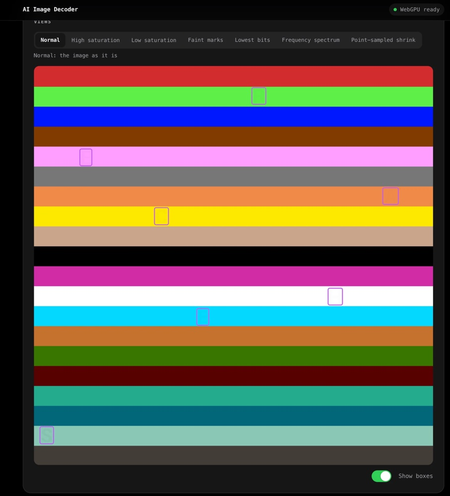
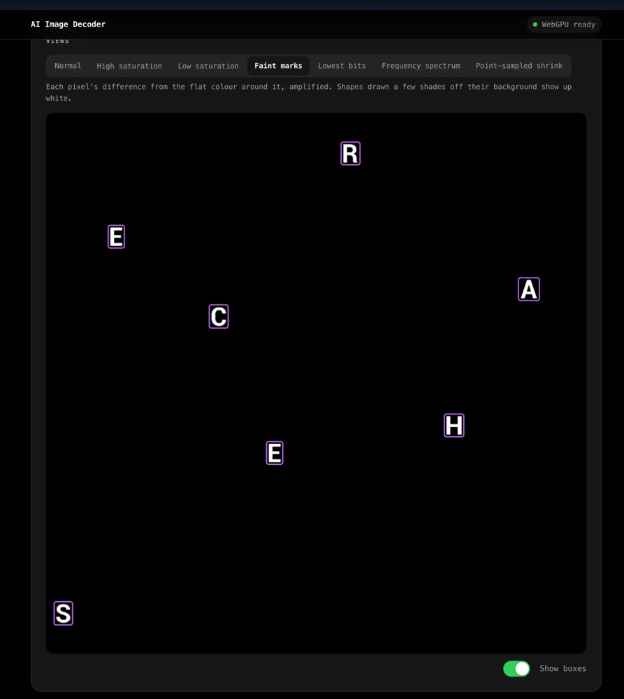
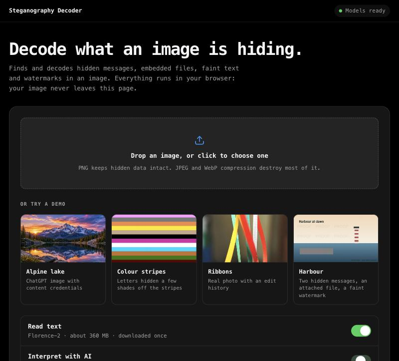
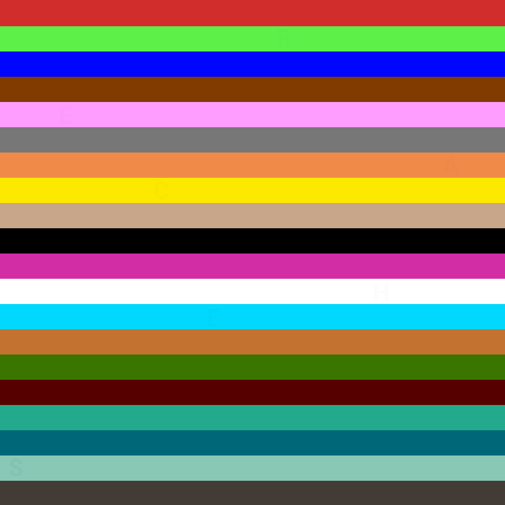
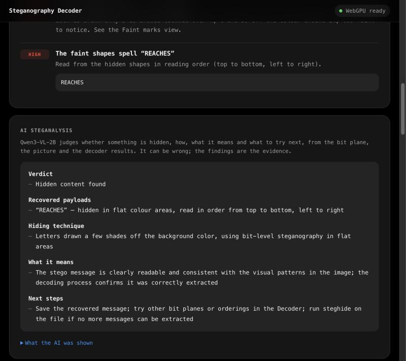
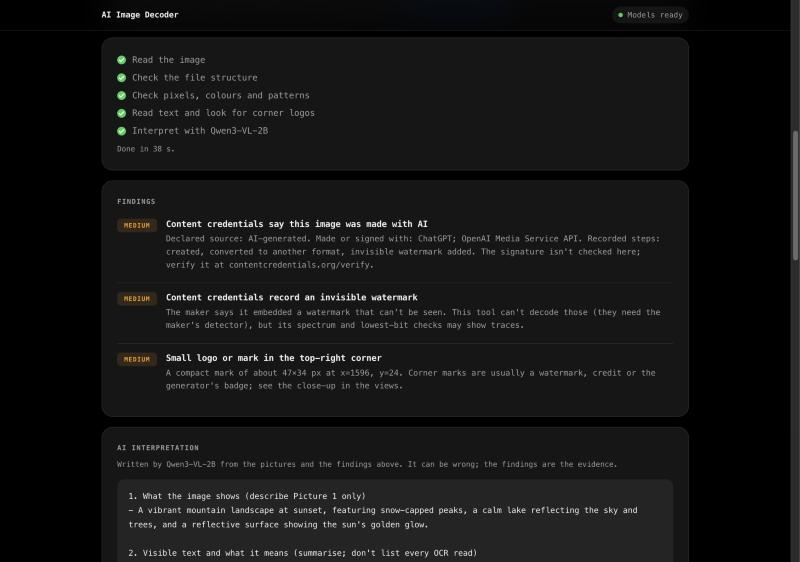
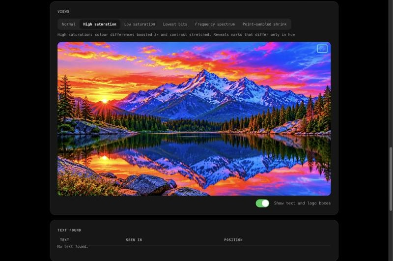

# AI Image Decoder

Find text, watermarks, colour patterns and hidden data in an image, with AI models that run entirely in your browser. No server, no API key, and your image never leaves the page.

**[▶ Try the live demo on Hugging Face Spaces](https://huggingface.co/spaces/GHeart01/ai-image-decoder)**

<table>
  <tr>
    <td width="50%"></td>
    <td width="50%"></td>
  </tr>
  <tr>
    <td><b>What you see:</b> twenty colour stripes. The purple boxes mark where the app found something you can't see.</td>
    <td><b>What the app sees:</b> seven letters, each only 5–18 shades off its stripe. Read in order, they spell <b>REACHES</b>.</td>
  </tr>
</table>

Run this image through the app and it reports: **7 faint shapes hidden in flat colour** and **The faint shapes spell “REACHES”**. Try it yourself: it's the *Colour stripes* demo in the [live app](https://huggingface.co/spaces/GHeart01/ai-image-decoder).

## Real demos

Both images below are one-click demos in the app, and everything shown is the app's actual output.



<p>
  
  
</p>

| | Alpine lake | Colour stripes |
|---|---|---|
| **What it is** | An image generated with ChatGPT | Twenty flat colour stripes |
| **Content credentials (C2PA)** | AI-generated by ChatGPT / OpenAI Media Service API; created, converted, invisible watermark added | None |
| **Hidden in the picture** | A small, faint logo in the top-right corner (47×34 px) | Seven letters, each only 5–18 shades off its stripe, spelling **REACHES** |
| **Hidden data in the file** | None | None |

### Colour stripes: findings and AI interpretation

The faint-mark check finds seven shapes that differ from their stripe by only a few shades, lines them up in reading order and reads them: **REACHES**.



### Alpine lake: findings and AI interpretation

The file checks read the credentials, the corner check finds the faint logo, and Qwen3-VL-2B describes the scene and what the credentials mean.



### Alpine lake: high-saturation view

Exaggerating colour differences is how the app exposes marks that blend into the image. The blue box is the corner logo the app found.



### More demos in the app

- **Ribbons:** a real photo whose credentials record it being opened and colour-adjusted.
- **Harbour:** a generated test image. The app finds everything planted: a ZIP file attached after the image, a sentence hidden in the pixels' lowest bits, a PNG comment, a 4%-opacity "PROOF" watermark, and colour-camouflaged text.

## What it checks

| Layer | How | Model |
|---|---|---|
| **File structure** | EXIF, XMP and PNG text fields; AI-generation prompts (Stable Diffusion, ComfyUI); non-standard blocks; data appended after the image | none |
| **Content credentials** | Reads the C2PA manifest: declared source (camera, AI-generated, AI-edited…), the tool that made it, and recorded steps such as edits or an added invisible watermark | none |
| **Lowest bits** | Extracts messages in the orderings simple tools use, runs a chi-square attack, and compares aligned and misaligned value pairs in flat areas, counting only scattered flips (a solid faint shape isn't noise) | none |
| **Faint marks** | In flat-colour artwork: shapes enclosed by one flat area and only a few shades off its colour. Shown amplified in a Faint marks view, lined up in reading order and read with OCR | Florence-2-base (to read them) |
| **Frequency** | 2-D FFT; isolated peaks reveal grids, halftone, moiré and frequency watermarks | none |
| **Colour** | Palette with plain colour names, saturation, histogram gaps, lowest-bit colour twins | none |
| **Resizing** | Compares an averaged and a point-sampled shrink to catch image-scaling attacks | none |
| **Text** | OCR on 768 px tiles of three views (normal, high saturation, low saturation). Text that only appears in an enhanced view is flagged | [Florence-2-base](https://huggingface.co/onnx-community/Florence-2-base-ft), ~360 MB |
| **Corner logos** | Each corner is cropped and Florence-2 is asked to locate "logo". With nothing there it returns the whole crop; a small, tight box near the edges is a mark | Florence-2-base |
| **Interpretation** | Gets the image shrunk to ~0.5 megapixel, a saturated copy, close-ups of flagged regions and all findings, and writes a short report under six headings | [Qwen3-VL-2B-Instruct](https://huggingface.co/onnx-community/Qwen3-VL-2B-Instruct-ONNX), ~1.4 GB |

The pixel and file checks finish in under a second. Once the models are stored, they load in the background when the page opens, and a full 1920×1080 analysis takes about 25 seconds on an idle Apple Silicon laptop (closer to 45–50 seconds when the machine is busy).

## Design

One monospace type stack (SF Mono, Cascadia Mono and friends: no web fonts, so nothing is fetched beyond the app and its models), Apple-style materials (a translucent top bar with a live model-status pill, switches, a segmented control) and restrained motion: press feedback, hover only on real pointers, a short staggered reveal for results, and everything reduced under `prefers-reduced-motion`. Light and dark follow the system.

## Quick start

Run it locally with any static file server. You need one because browsers block ES modules on `file://` pages.

```bash
git clone https://github.com/GHeart01/ai-image-decoder.git
cd ai-image-decoder
python3 -m http.server 8000
```

Open <http://localhost:8000> and click a demo. Text reading and AI interpretation need a browser with WebGPU (Chrome, Edge or Safari 26+). Without WebGPU, the file and pixel checks still work, and text reading is designed to fall back to the CPU (slower, and untested so far).

## How it works

1. **Exact pixels.** PNGs are decoded in JavaScript, so pixel values are exact. Browser (canvas) decoding can be altered by colour management and by anti-fingerprinting noise, which would destroy lowest-bit evidence. The app tests for that noise and warns when it's present.
2. **File and pixel checks** run on the main thread in [`lib/`](../lib): [`metadata.js`](../lib/metadata.js) for the file structure and C2PA, [`forensics.js`](../lib/forensics.js) for the lowest bits, frequency, colour and resizing, and [`views.js`](../lib/views.js) for the saturation views.
3. **The models run in a Web Worker** ([`worker.js`](../worker.js)) with [Transformers.js](https://huggingface.co/docs/transformers.js) on WebGPU. With 8 GB or more of memory both stay loaded between images; on smaller machines only one is kept at a time, because integrated GPUs share system RAM. The worker runs one model job at a time: ONNX Runtime stalls if a model is set up while another is running.
4. **Text reading** cuts each view into overlapping 768 px tiles (Florence-2's input size) and merges the reads ([`pipeline.js`](../lib/pipeline.js)). Reads at the same place are combined even when tiles or views spell them differently.
5. **Interpretation** sends Qwen3-VL several pictures plus the findings. Text taken from the image or file goes inside a delimited data block that the model is told never to follow, and `<` and `>` are stripped so that text can't close the block early.

### Storage

The models download once and are stored in the browser's private file system (OPFS) rather than the Cache API, which refused Qwen's 995 MB weights file in testing. The page shows what's stored and has a **Remove downloaded models** link.

## Tests

The forensic checks are tested against planted ground truth and clean controls, including several cases found on real images: dithered gradients, near-black noise, OCR misreads at tile edges, tall phantom text boxes, and the soft edges of faint letters.

```bash
cd tests
npm install
npm test
```

## Deploy your own copy

The app is a free **static** [Hugging Face Space](https://huggingface.co/docs/hub/spaces). With the [`hf` CLI](https://huggingface.co/docs/huggingface_hub/guides/cli) logged in (`hf auth login`), run this from the repo folder, replacing `<username>`:

```bash
hf repos create <username>/ai-image-decoder --type space --sdk static
```
```bash
hf upload <username>/ai-image-decoder . --type space --exclude ".git/*" --exclude ".github/*" --exclude "tests/node_modules/*"
```

The root [`README.md`](../README.md) holds the Space's settings in its front matter, so keep that file. This page lives in `.github/README.md` so that GitHub shows it instead. Any other static host works too.

## Limitations

- **Lossy files:** JPEG and WebP compression rewrite the lowest bits, so hidden-bit results on those formats are weak evidence.
- **Invisible model watermarks** (OpenAI's, SynthID, Stable Diffusion's DWT-DCT mark) can't be decoded; they need the maker's detector. The app reports when content credentials *say* one was added.
- **Content credentials aren't verified.** The app reads what the manifest claims; check the signature at [contentcredentials.org/verify](https://contentcredentials.org/verify).
- **Logos away from the corners:** there's no trained logo or watermark detector. Corner marks are found by the grounding check above; elsewhere, watermarks are inferred from repeated text, text that appears only after enhancement, and the AI's reading.
- **The AI interpretation can be wrong.** Qwen3-VL-2B is small: in testing it sometimes named colours wrong or left a finding out of its summary. The raw findings always appear above it.
- **Tested in Chrome on Apple Silicon.** The no-WebGPU path, Safari and 16-bit PNGs haven't been tested.

## Credits

- Models: [Florence-2-base](https://huggingface.co/microsoft/Florence-2-base-ft) (MIT) and [Qwen3-VL-2B-Instruct](https://huggingface.co/Qwen/Qwen3-VL-2B-Instruct) (Apache-2.0), using the ONNX exports from [onnx-community](https://huggingface.co/onnx-community)
- Runtime: [Transformers.js](https://github.com/huggingface/transformers.js) by Hugging Face
- PNG decoding: [fast-png](https://github.com/image-js/fast-png)
- Demo images: see [`demo/README.md`](../demo/README.md)
